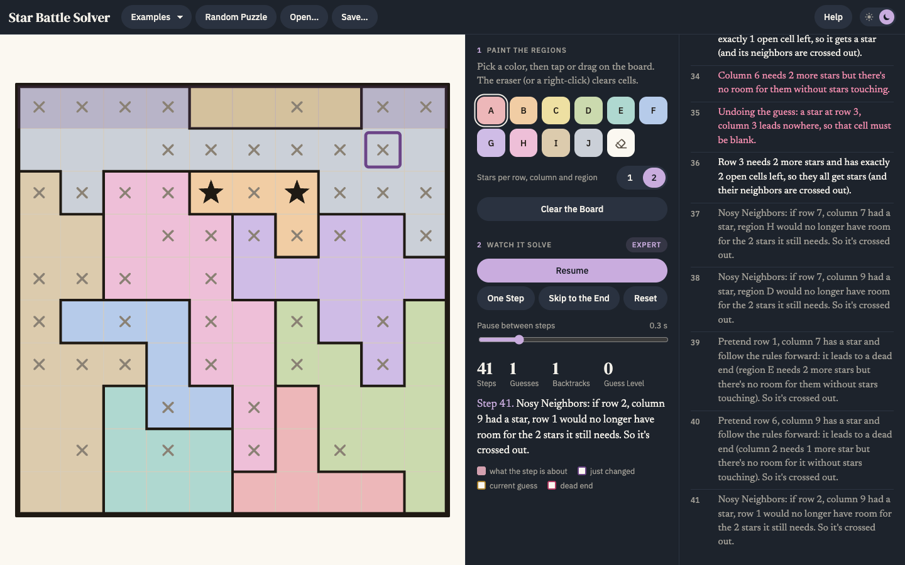

# Star Battle Solver

A web app that **solves Star Battle puzzles step by step, explaining every step in plain English**. Paint in a puzzle
from a book or app, load an example, or make a brand-new random puzzle at the difficulty you choose (Easy, Medium,
Hard or Expert), then watch it solved.

**Open it:** [carsonmit.github.io/Widgets-and-Miscellaneous/StarBattleSolver/](https://carsonmit.github.io/Widgets-and-Miscellaneous/StarBattleSolver/)



It works in Safari, Chrome, Firefox and Edge on a computer, tablet or phone, with a mouse or a finger, and needs no
account and no installation. On an iPhone or iPad you can add it to the home screen, where it opens like an app and
works offline.

The solver itself started as a Python program, `solver.py`. The web app uses an exact JavaScript translation of it,
`solver.js`, and the tests check that both take the same steps on every puzzle.

---

## Contents

1. [What is Star Battle?](#what-is-star-battle)
2. [Using the app](#using-the-app)
3. [Difficulty levels](#difficulty-levels)
4. [Puzzle file format](#puzzle-file-format)
5. [Running it on your own computer](#running-it-on-your-own-computer)
6. [Using the Python version](#using-the-python-version)
7. [How the solver works](#how-the-solver-works)
8. [How random puzzles are made](#how-random-puzzles-are-made)
9. [Files in this folder](#files-in-this-folder)
10. [Running the tests](#running-the-tests)
11. [Troubleshooting](#troubleshooting)
12. [Limitations and ideas for improvement](#limitations-and-ideas-for-improvement)

---

## What is Star Battle?

You get a 10×10 grid split into 10 colored **regions**. Place stars so that:

1. every **row** has exactly **2** stars,
2. every **column** has exactly **2** stars,
3. every **region** has exactly **2** stars, and
4. **no two stars touch**, not even diagonally.

A well-made puzzle has exactly one answer.

## Using the app

The app wears the same colors and fonts as [carsonmit.github.io](https://carsonmit.github.io), with the same Night/Day
switch (top right). The board itself is always paper with pastel regions.

### 1. Get a puzzle

| What you want | How |
|---|---|
| A ready-made puzzle | **Examples**: one each of Easy, Medium, Hard and Expert |
| A brand-new puzzle | **Random Puzzle**, then pick a difficulty |
| Paint your own | Pick a color A–J (or press `1`–`9`, `0`), then tap or drag on the board |
| Erase cells | The eraser swatch (or press `E`), or right-click / right-drag with a mouse |
| Start over | **Clear the Board** |
| Save or load a puzzle file | **Save…** / **Open…** (plain text files, the same ones the Python version uses) |

**Tip for copying a puzzle from a book or app:** the colors don't have to match. All that matters is which cells
share a region. Thick borders appear automatically between regions, so you can compare against the original.

The app checks the puzzle as you paint. Under the swatches it tells you what's missing ("3 cells still need a
color", "needs exactly 10 regions, but this one has 9", a region too small to hold its stars), and **Solve** won't
start until those are fixed. Once the board is complete, it works out in the background whether the puzzle has
exactly one answer, none, or several, and shows the result beside "Watch It Solve": the puzzle's difficulty, **No
Answer** or **Several Answers**. Regions split into separate pieces are allowed, but the app asks first.

### 2. Watch it solve

| Button | What it does |
|---|---|
| **Solve** | Plays the solution step by step. While it's playing, the same button is **Pause** / **Resume**. |
| **One Step** | Shows exactly one more step (or press `→`). |
| **Skip to the End** | Jumps straight to the answer. |
| **Reset** | Removes the stars and crosses. (Painting a cell does this automatically.) |
| **Pause between steps** | From none to 1.5 seconds. |

**Reading the board:** ★ is a star and × is a cell that can't hold one. A **plum box** marks the cells the latest
step changed, a **gold box** the cell being guessed, and a **red box** a dead end. **Guess level** is how many guesses
deep the solver currently is: 0 means everything on the board was proven by logic. **Every Step** lists each step
with its reason: guesses in gold, dead ends in red.

The solving, grading and puzzle-making happen in a helper that works in the background (`worker.js`), so the page
never freezes. If a strange home-made puzzle takes longer than 30 seconds to solve, the app stops and says so.

### Keyboard shortcuts

`1`–`9` and `0` pick colors A–J · `E` eraser · `Space` solve or pause · `→` one step. With the board selected (press
`Tab`), the arrow keys move around it, `Enter` paints and `Delete` erases.

## Difficulty levels

A puzzle's difficulty is decided by watching the solver, which always tries its simplest rule first and only reaches
for a harder one when every simpler rule is stuck (the rules are explained [below](#the-four-rules)):

| Level | What the solver needs | Share of random puzzles |
|---|---|---|
| **Easy** | Rules 1–3 only (counting, squeeze, quick what-if). No guessing. | about 27% |
| **Medium** | Rule 4 (deep what-if) at least once. No guessing. | about 47% |
| **Hard** | All four rules get stuck, so it has to guess, but never more than one guess at a time. | about 17% |
| **Expert** | It has to guess while already inside a guess (guess level 2 or more). | about 8% |

The shares come from 300 random puzzles. The solver takes the same steps every time on the same puzzle, so a
puzzle's grade never changes, and `gradePuzzle()` in `generator.js` can grade any puzzle, including ones you paint.
**Random Puzzle** keeps making puzzles and grading them until one has the level you picked, so the puzzle you get
really is that level. That's why Expert takes longest: on a computer usually a few seconds, sometimes up to half a
minute on a phone. The tests check that the examples and random puzzles have the levels they claim.

The grades describe what *this solver* needs. A person may know shortcuts the solver doesn't (see
[Limitations](#limitations-and-ideas-for-improvement)), so a "Hard" puzzle may feel easier to an expert player.

## Puzzle file format

A puzzle is a plain text file with 10 lines of 10 characters. Each character is the region that cell belongs to:

```
# Lines starting with # are comments and are ignored.
HHHHGGGJJJ
HCHHGGGIII
CCHCGGGIII
CCCCGGGIII
CCCCGGGEII
FFFDDGGEII
FDDDDDEEBI
ADADDDBEBI
AAAABBBBBB
AAAAAABBBB
```

- Any 10 different symbols work: letters, digits, anything. Spaces inside a line are ignored.
- Files saved from the app always use the letters A–J.

## Running it on your own computer

Double-clicking `index.html` opens a working copy in your browser. For offline use and the home-screen icon it has
to come from a web address, which this folder already does on GitHub Pages. To serve it yourself:

```bash
cd StarBattleSolver
python3 -m http.server 8000
```

Then open `http://localhost:8000` in your browser.

## Using the Python version

`solver.py` and `puzzle_generator.py` need only Python 3.8 or newer (no extra installs).

**From a terminal:**

```bash
python3 solver.py puzzles/example_4_expert.txt
```

This prints the solution (`*` = star, lowercase letters = regions) and how long it took. For a 1-star puzzle, add the
star count: `python3 solver.py my_puzzle.txt 1`.

**Generate a random puzzle:**

```bash
python3 puzzle_generator.py > puzzles/my_new_puzzle.txt
```

**From your own Python code:**

```python
from solver import StarBattleSolver, load_puzzle

puzzle = load_puzzle("puzzles/example_2_medium.txt")   # or a list of 10 strings
solver = StarBattleSolver(puzzle, stars=2)

answer = solver.solve()              # list of rows of True/False, or None if impossible
print(solver.guesses, "guesses")

# Is the answer unique?
print(StarBattleSolver(puzzle).count_solutions(limit=2))   # 1 means unique

# Step by step, the same way the app animates it:
for step in StarBattleSolver(puzzle).solve_steps():
    print(step.action, step.message)
```

The JavaScript version works the same way: `new StarBattleSolver(rows, 2)`, then `solveSteps()`, `solve()` or
`countSolutions(2)`.

## How the solver works

The code is commented line by line in beginner-friendly language (`solver.py` has the longest explanations). This
section is the overview.

### The big idea: logic first, guess only when stuck

Every cell is always **unknown**, **star** or **blank** (definitely no star). The solver repeats a cycle:

```
          ┌──────────────────────────────────────────────┐
          ▼                                              │
  1. LOGIC: apply Rules 1-4 until none of them helps     │
          │                                              │
          ├── board broke? ──► this branch is wrong      │
          ├── board full?  ──► SOLVED                    │
          ▼                                              │
  2. GUESS: put a pretend star on a carefully chosen     │
            cell, and repeat the whole cycle on a COPY   │
          │                                              │
          ▼                                              │
  3. If the copy breaks: throw it away. Now we KNOW that │
     cell is blank, which is real progress ─────────────┘
```

Computer scientists call this **constraint propagation with backtracking search**. The rules (constraint
propagation) do almost all of the work, so very few guesses are needed.

### The four rules

A **unit** means any row, column or region. Each needs exactly 2 stars.

**Rule 1: Counting.** For every unit:
- if it already has its 2 stars, cross out the rest of it;
- if the number of open cells equals the number of stars it still needs, they're all stars;
- if it can't possibly fit the stars it needs without them touching, the board is broken.

Every time a star is placed, its 8 neighbors are crossed out, because stars can't touch.

**Rule 2: Squeeze (pigeonhole).** Take a band of, say, 3 neighboring rows. It holds exactly 3 × 2 = 6 stars.
- If 3 regions lie **entirely inside** the band, they need all 6 of those stars, so every band cell belonging to any
  other region is crossed out.
- If only 3 regions **touch** the band at all, the band's 6 stars must come from them, which fills them up. So their
  cells **outside** the band are crossed out.

This is checked for every band of rows and every band of columns, of every width.

**Rule 3: Quick what-if.** For each open cell, imagine a star there for a moment. It would cross out its neighbors,
and it might complete its row, column or region. Would some unit then be left without room for its stars? If so, the
star can't go there, so the cell gets crossed out.

**Rule 4: Deep what-if.** Like Rule 3, but the solver follows the consequences further. On a scratch copy of the
board, it places the pretend star and keeps applying Rules 1 and 2 like falling dominoes. If that chain reaction ends
in something impossible, the cell gets crossed out on the real board. The scratch work isn't shown, only the
conclusion. This is the rule that keeps the number of real guesses so low.

Rules are tried cheapest first. Whenever one makes progress, the solver goes back to Rule 1, because new information
often unlocks the simple rules again.

### Choosing a good guess

When all four rules are stuck, the solver:

1. finds the unit with the **fewest ways** left to place its remaining stars (for example, "needs 1 star and has only
   2 open cells" means just 2 ways), and
2. in that unit, picks the cell whose star would **cross out the most open neighbors**.

A guess like that either succeeds or fails quickly. Failing still helps, because the cell then becomes a proven blank.

### How "step by step" works

`solveSteps()` (in Python, `solve_steps()`) is a **generator**: a function that can pause partway through. Each time
the solver does something worth showing, it hands back a step containing the action type, the cells involved, a
plain-English message, a snapshot of the whole board, and the current guess level. The app collects these steps in the
background and then plays them back at the speed you choose. The solver doesn't know anything about the page, and the
page doesn't need to know how the solver thinks.

### Why it's efficient

- **The rules do the work.** About three quarters of random puzzles need no guesses at all.
- **Smart guesses.** Guessing in the most constrained place keeps the search tiny.
- **Cheap bookkeeping.** Cells are numbered 0–99 in one flat list, so copying the board for a guess is quick. Each
  cell's neighbors and units are worked out once at the start. Rule 2 stores which rows and columns each region touches
  as a *bitmask* (a whole number used as a row of on/off switches), so it can compare whole sets in one operation.
- **Skipping needless work.** Rule 3 only re-checks the units an imaginary star would actually affect, and Rule 4
  skips board snapshots during its silent scratch work.

## How random puzzles are made

`generator.js` (a translation of `puzzle_generator.py`) builds the answer first and the puzzle around it:

1. **Secretly place 20 valid stars:** 2 per row, 2 per column, none touching.
2. **Pair the stars up** and draw a short path between the two stars of each pair. Each path is the seed of one region.
3. **Grow the 10 regions outward** at random until every cell belongs to one. Each region now contains exactly 2
   secret stars, so the secret answer is valid.
4. **Ask the solver whether there's a second answer.** If there is, find a cell that has a star in the unwanted answer
   but not in the secret one, and hand that cell to a neighboring region (keeping regions in one piece). The secret
   answer is unaffected, but the unwanted one now has 3 stars in one region and 1 in another, so it's ruled out.
   Repeat until only one answer remains.
5. **Grade it** (see [Difficulty levels](#difficulty-levels)) and keep it only if it has the level you asked for.

One puzzle takes about a third of a second on a laptop. The generator checks for a second answer without Rule 4,
because it solves many throwaway puzzles and only needs speed there.

## Files in this folder

```
StarBattleSolver/
├── index.html            ← the web app: the page, its look, and playing back the steps
├── solver.js             ← the solving logic, in JavaScript (a translation of solver.py)
├── generator.js          ← random puzzles and difficulty grading, in JavaScript
├── worker.js             ← runs solving and puzzle-making in the background
├── manifest.webmanifest  ← name and icon for "Add to Home Screen"
├── sw.js                 ← lets the app open offline once visited
├── icon.svg              ← browser-tab icon: cream in a light browser, charcoal in a dark one
├── icon-180.png, icon-512.png, icon-maskable-512.png   ← home-screen icons
├── solver.py             ← the original solving logic, in Python
├── puzzle_generator.py   ← makes random puzzles in Python
├── test_solver.py        ← automatic tests (Python, plus the JavaScript via Node.js)
├── puzzles/              ← the example puzzles (plain text)
│   ├── example_1_easy.txt
│   ├── example_2_medium.txt
│   ├── example_3_hard.txt
│   └── example_4_expert.txt
├── screenshot.png
└── README.md
```

The app keeps its own copy of the four examples inside `index.html`, so it works without a web server; a test checks
the copies match the files.

## Running the tests

```bash
cd StarBattleSolver
python3 -m unittest test_solver.py
```

The tests check that:

- every example is solved correctly and has exactly one answer;
- random puzzles are unique and solved correctly;
- a 6×6 one-star puzzle works;
- an impossible puzzle is reported as having no solution;
- bad input is rejected;
- the step-by-step reports are well-formed;
- the web app's `solver.js` takes **exactly the same steps** as `solver.py` (same messages, same boards) on the
  examples and 10 random puzzles;
- each example's difficulty matches its name, and the app's copy of it matches the file; and
- the app's random puzzles have the difficulty asked for, with exactly one answer.

The last three need [Node.js](https://nodejs.org) (a program that runs JavaScript outside a browser) and are skipped
without it. All answers are double-checked by `check_solution()`, which tests the four rules independently of the solver.

## Troubleshooting

| Problem | Fix |
|---|---|
| **Solve** does nothing and a red line appears under the swatches | The puzzle isn't finished: the line says what's missing (unpainted cells, the wrong number of regions...). |
| "No Answer" | Usually a painting mistake. Compare each region's outline with the original puzzle. |
| "Several Answers" | Also usually a painting mistake; the solver will still show one of the answers. |
| An Expert puzzle takes a long time | It's searching for a puzzle that really is Expert, which only about 1 in 12 random puzzles is. Wait, or press **Cancel**. |
| Right-click doesn't erase on a Mac | Use a two-finger click, or the eraser swatch. |
| `python` isn't recognized | Try `python3`, or on Windows `py`. |

## Limitations and ideas for improvement

- **The app is fixed at 10×10.** The solvers and generators work for any size; the app would need a size selector.
- **Rule 4 isn't how humans usually think.** Its "follow the dominoes" reasoning is valid, but it can chain several
  steps together that a person would write out one at a time. Each message names the dead end it found, so you can
  check the reasoning yourself.
- **More human techniques** could be added as named rules, which would also make the difficulty levels closer to how
  people experience them. One example is the 2×2 block rule: every 2×2 square holds at most one star, and tiling an
  area with such squares gives an upper limit on how many stars that area can hold.
- **The Python version can't grade difficulty.** Grading lives in `generator.js`; it could be translated back.
